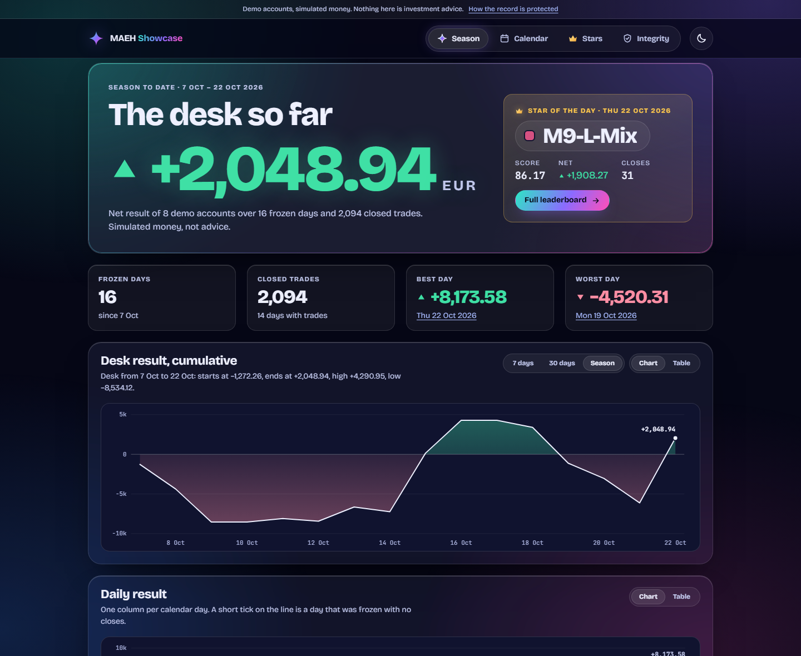
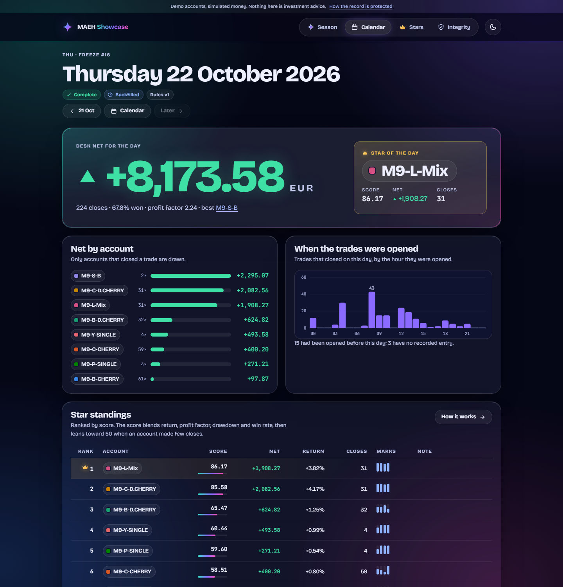
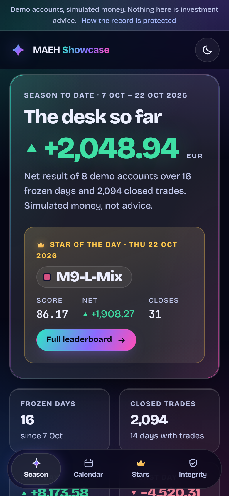
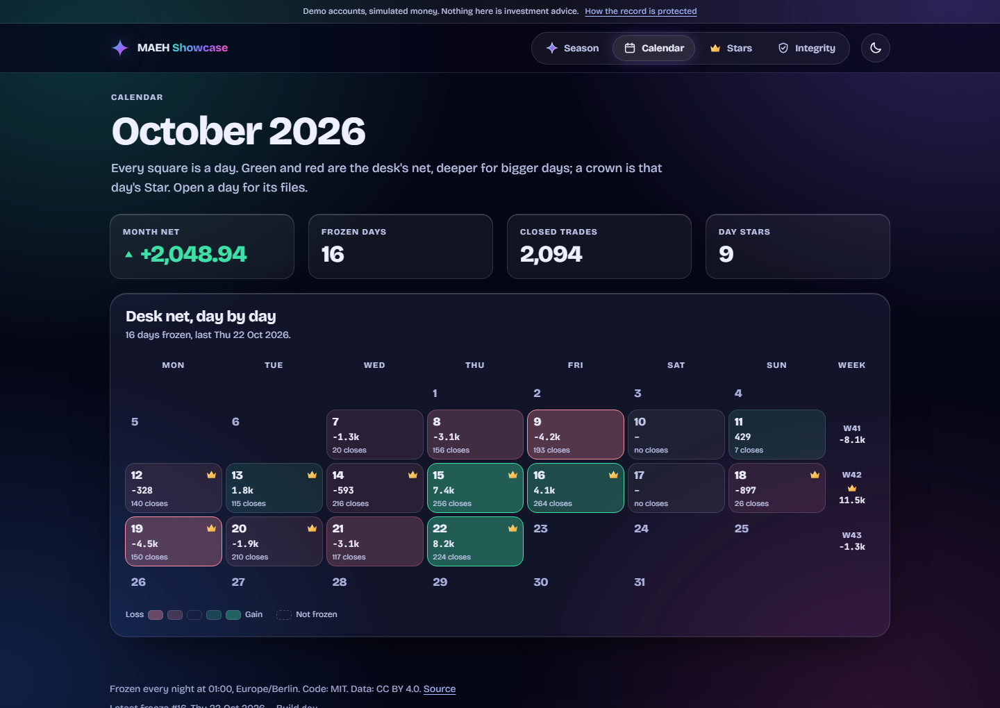
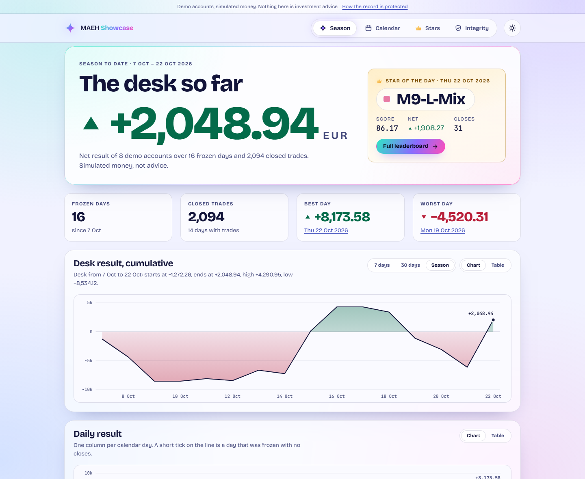

# MAEH Showcase

**Eight demo trading accounts. Every night at 01:00 the previous day's results are checked and frozen
into plain files, ranked with Star crowns, and published as a dashboard anyone can verify.**

[](https://github.com/IllimitedEnterprise/MAEH-Showcase/actions/workflows/ci.yml)
[](https://github.com/IllimitedEnterprise/MAEH-Showcase/actions/workflows/pages.yml)

**Live dashboard: <https://illimitedenterprise.github.io/MAEH-Showcase/>**

> Every account here is a **demo account** trading **simulated money**. Nothing in this repository is
> investment advice, and a score or a crown describes what happened, never what will. See
> [DISCLAIMER.md](DISCLAIMER.md).



## What this is

The accounts run on the Multi-Account Execution Harness (MAEH). This repository is the public,
read-only record of how they did:

- **Frozen days.** After each local day ends, its results are written once into
  `results/YYYY/MM/YYYY-MM-DD/`, hashed, and chained to the day before. A frozen day is never edited.
- **Star ranking.** Each day, week and month the top-ranked account that finished in profit wears the
  crown. The score and every rule are public: [`stars/RULES.md`](stars/RULES.md).
- **A dashboard** that draws all of it: a season overview, a calendar, a page per day with every file
  readable next to its raw bytes, a page per account, the standings, and an integrity page that checks
  the whole hash chain in your own browser.

<table>
<tr>
<td width="62%"></td>
<td width="38%"></td>
</tr>
<tr>
<td><sub>A day: the desk result, the Star, the standings and every frozen file.</sub></td>
<td><sub>Phone layout, dark. A light theme is one tap away.</sub></td>
</tr>
</table>

<table>
<tr>
<td width="50%"></td>
<td width="50%"></td>
</tr>
<tr>
<td><sub>The calendar: every day a square, deeper for bigger days; a crown is that day's Star.</sub></td>
<td><sub>The light theme, same data, same rules.</sub></td>
</tr>
</table>

## Where things are

```
results/                          FROZEN. Append-only. CC BY 4.0.
  index.json  series.json         the catalogue of days and the cumulative series (derived)
  2026/10/2026-10-22/             one folder per day, named for the local calendar day
    README.md                     the day in words
    day.json                      the manifest: window, status, every file's SHA-256, link to the day before
    desk.json  stars.json         the whole desk, and that day's Star standings
    accounts/<account>/           summary.md  summary.json  trades.json  trades.csv  hours.json
stars/                            DERIVED. Rebuilt from results/ by `node scripts/rank.mjs`.
  RULES.md  leaderboard.*  crowns.json  history/  accounts/<account>.md|json
site/                             the static dashboard (plain HTML, CSS and JavaScript modules)
config/                           season settings, the published-account list, the versioned ranking rules
scripts/                          the command line tools; scripts/lib has their modules
test/                             the tests (node --test)
docs/                             METHODS, OPERATIONS, DESIGN, PROGRESS
deploy/hermes/                    the files that wire the nightly job to the Hermes agent
.agents/skills/maeh-showcase/     the skill the agent follows
```

## Check it yourself

Nothing to install: Node 22 or newer and Git are enough, and there are no dependencies.

```sh
git clone https://github.com/IllimitedEnterprise/MAEH-Showcase.git
cd MAEH-Showcase
node scripts/verify.mjs --all      # every file against its hash, the chain, the rules, privacy
node scripts/rank.mjs --check      # rebuild the Star files and compare byte for byte
node --test "test/**/*.test.mjs"   # the whole test suite
```

`verify` recomputes every SHA-256, walks the chain from the first day to the newest, re-derives each
day's window and figures from its own trade file, and scans every public file for anything private. It
exits 1 and names the file if anything is off.

On the dashboard, the **Integrity** page does the chain walk in the browser, and each **day** page has
a *Check every file* button; both hash the files locally and compare them with the manifest.

## Run the dashboard locally

```sh
node scripts/serve.mjs             # http://127.0.0.1:4173/MAEH-Showcase/
```

The preview serves the page and the two data folders and nothing else, on the loopback address only.

## How the nightly freeze works

At 01:00 (Europe/Berlin, daylight saving aware) a scheduled job runs `node scripts/nightly.mjs`. It
reads the previous day's closed trades from the harness, builds the day's files in a temporary folder,
verifies them, moves them into place in one step, rebuilds the Star files, runs the full verification,
and only then commits and pushes. The push redeploys the site. If anything is wrong, nothing is
published and the failure is reported; a clean night makes no noise. Details, exit codes and recovery
steps: [docs/OPERATIONS.md](docs/OPERATIONS.md).

## What is, and is not, published

Public: account labels, per-trade rows (symbol, side, net result, R multiple), and how many trades were
opened in each hour of the day. Never: tickets, comments, volume, prices, trade times, broker logins or
servers, file paths, ports, harness ids, strategy names, equity or floating figures, raw error text.
Every public object is built from an allowlist, and `verify` scans the files again. How every number is
computed, and what the chain does and does not prove: [docs/METHODS.md](docs/METHODS.md).

## Documents

| | |
|---|---|
| [docs/METHODS.md](docs/METHODS.md) | The definitions: the day, the sources, the metrics, the score, the crowns, the chain |
| [docs/OPERATIONS.md](docs/OPERATIONS.md) | Running it: the nightly job, its outcomes, the agent, recovery, publishing |
| [docs/DESIGN.md](docs/DESIGN.md) | The dashboard: look, colour, accessibility, security, how it is built and tested |
| [docs/PROGRESS.md](docs/PROGRESS.md) | What was built, in what order, and what was checked |
| [AGENTS.md](AGENTS.md) | The rules for automated agents and maintainers |

## Licence

Code: MIT ([LICENSE](LICENSE)). Data in `results/` and `stars/`: CC BY 4.0
([LICENSE-DATA.md](LICENSE-DATA.md)): use it freely, and say where it came from. The bundled fonts are
under the SIL Open Font License ([site/assets/fonts/FONTS.md](site/assets/fonts/FONTS.md)).
